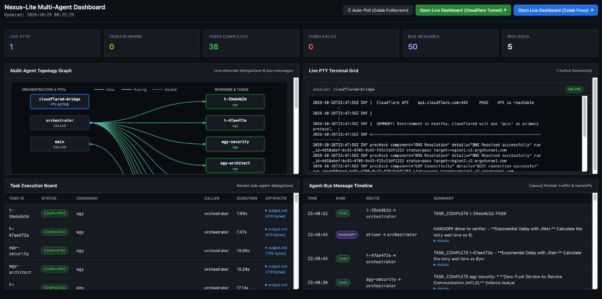
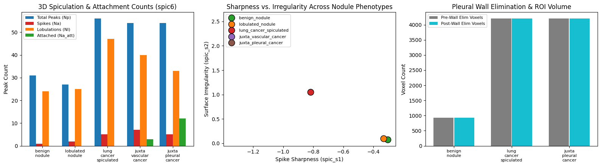
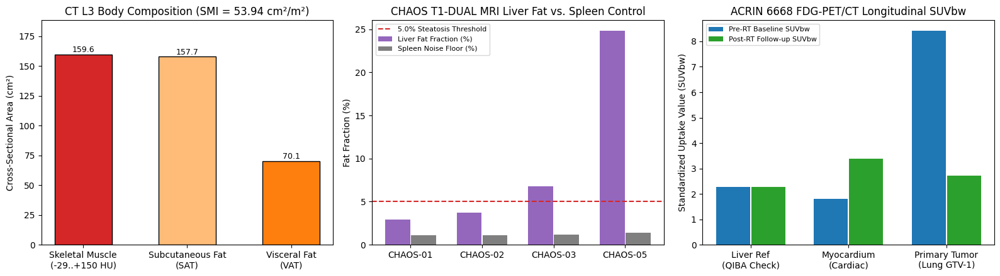
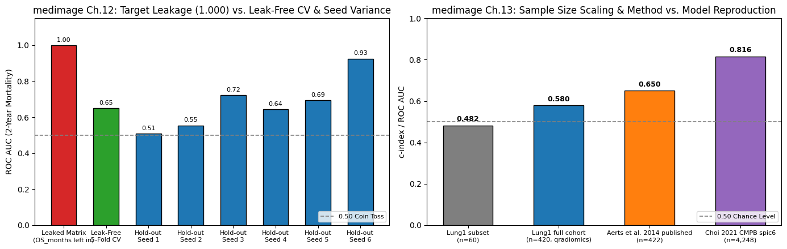

Today we are excited to release **[nexus-lite](https://github.com/choilab-jefferson/nexus.lite)** (`v0.2.2`, MIT License), an ultra-lightweight, Colab-ready multi-agent orchestration kernel and scientific workflow suite designed to coordinate live CLI coding and research agents—including **Google Antigravity (`agy`)**, **OpenCode (`opencode`)**, **Claude Code (`claude`)**, local **Ollama** GPU/CPU models (`gemma4`, `qwen3.8`, `lfm3`), and our sandboxed single-agent leaf CLI **[loom](/loom/)** (`v0.2.3`)—directly on top of **[qradiomics](/qradiomics/)** (`v0.9.6`) and **[medimage](/posts/2026-08-04-introducing-medimage/)**.

With **[qradiomics](/posts/2026-05-20-introducing-qradiomics/)**, we unified twelve years of CHOI Lab radiomics and 3D shape pipelines into an atomic Python CLI and library (`qr` / `qrdx`). With **[medimage](/posts/2026-08-04-introducing-medimage/)**, we turned those tools into a 13-chapter hands-on Google Colab curriculum. **`nexus-lite` completes the stack**: it gives multiple AI agents a shared, zero-server workspace where they can run parallel radiomics extractions, audit DICOM de-identification under an opt-in PHI gate (`NEXUS_SENSITIVITY=phi`), detect survival data leakage, execute hidden-test IBSI radiomics verification benchmarks with **[loom](/loom/)**, ship zero-preinstall remote compute bundles over Cloudflared tunnels, and index every finding into a searchable SQLite FTS5 knowledge wiki—all inside a single Google Colab notebook or local workstation.

- **Repository:** [github.com/choilab-jefferson/nexus.lite](https://github.com/choilab-jefferson/nexus.lite) · **PyPI:** [`pip install nexus-lite`](https://pypi.org/project/nexus-lite/) (or `pip install "nexus-lite[demos]"`) · **Version:** `v0.2.2` · **License:** MIT

### All 6 Interactive Google Colab Notebooks (`notebooks/`)

`nexus-lite v0.2.2` ships with **six self-contained Google Colab notebooks** spanning cloud CLI coding agents (`agy`, `claude`, `opencode`), sandboxed `loom` leaf-agent verification, zero-preinstall remote compute dispatch, and 100% local/PHI-safe open-weight LLM swarms on Colab T4, A100, and CPU runtimes:

| Colab Notebook | Runtime & What It Demonstrates |
| :--- | :--- |
| **1. Core Primitives**<br>[](https://colab.research.google.com/github/choilab-jefferson/nexus.lite/blob/main/notebooks/nexus_lite_colab_demo.ipynb) | **Free Colab (`agy`, `opencode`, `claude`, `loom`)** · `nexus_lite_colab_demo.ipynb` (18 cells)<br>Persistent `dtach` PTYs, Google Drive `~/.gemini` credential sync (`colab.ensure_colab`), Cloudflared tunnel (`colab.tunnel`), Bus v1 pointer injection, parallel swarms, role pipelines, 5-turn A2A `interact`, 5-phase `cooperate`, E2E test suite, and **Cell 9: Loom Multi-Agent IBSI Radiomics Verification**. |
| **2. QRadiomics + MedImage**<br>[](https://colab.research.google.com/github/choilab-jefferson/nexus.lite/blob/main/notebooks/qradiomics_medimage_colab_demo.ipynb) | **Free Colab (`agy`, `opencode`, `claude`, `loom`)** · `qradiomics_medimage_colab_demo.ipynb` (7 Demos, 28 cells)<br>Demo 1 (`qradiomics.shape` 3D `spic6` & 180-D `AHSN` swarm), Demo 2 (HIPAA Safe Harbor DICOM de-identification pipeline), Demo 3 (Multi-modality CT L3 body comp, CHAOS MRI steatosis, ACRIN 6668 PET SUV swarm), Demo 4 (Lung1 data-leakage & reproducibility audit), Demo 5 (5-phase cooperative `scanner_harmonizer.py`), Demo 6 (FTS5 Wiki + `viz.dashboard()`), and **Demo 7 (Loom 93-Test IBSI Radiomics Suite)**. |
| **3. Loom + IBSI Suite**<br>[](https://colab.research.google.com/github/choilab-jefferson/nexus.lite/blob/main/notebooks/loom_multi_agent_colab.ipynb) | **Free Colab (`loom`: `mock`, `anthropic`, `gemini`)** · `loom_multi_agent_colab.ipynb` (13 cells)<br>SHA-256-verified `loom.install_loom()`, `Orchestrator -> Workers -> Reviewer` vs. single-agent baseline on the 4-module `basic` task & 3 IBSI Radiomics suites (93 hidden tests), failure injection (`--inject-bad-key`, `--inject-timeout`), secret redaction, and **zero-preinstall remote compute (`nl.run_on_colab`) over `colab.tunnel`**. |
| **4. Local Swarm (T4)**<br>[](https://colab.research.google.com/github/choilab-jefferson/nexus.lite/blob/main/notebooks/local_llm_swarm_colab_t4.ipynb) | **Free Colab T4 GPU (15 GB VRAM · Ollama `gemma4:12b`)** · `local_llm_swarm_colab_t4.ipynb`<br>Runs a single 4-bit `gemma4:12b` (~8 GB VRAM, `OLLAMA_NUM_PARALLEL=2`) via `examples/ollama_agent.py` to drive a 3-agent parallel architecture/security/test swarm (`arch`, `sec`, `tests`) and a 3-stage sequential pipeline (`driver -> verifier -> documenter`) with **zero external API calls (PHI-safe)**. |
| **5. Local Swarm (A100)**<br>[](https://colab.research.google.com/github/choilab-jefferson/nexus.lite/blob/main/notebooks/local_llm_swarm_colab_a100_pro.ipynb) | **Colab Pro A100 GPU (40 GB VRAM · Ollama `qwen3.8:27b` + `gemma4:12b`)** · `local_llm_swarm_colab_a100_pro.ipynb`<br>Keeps both `qwen3.8:27b` (~18 GB) and `gemma4:12b` (~8 GB) hot in 40 GB VRAM (`OLLAMA_MAX_LOADED_MODELS=2`, `OLLAMA_NUM_PARALLEL=3`)—routing `arch`, `tests`, `driver`, and `documenter` to `qwen3.8:27b` while `sec` and `verifier` cross-audit on `gemma4:12b` with zero cold-swap latency. |
| **6. Tiny 6-Agent Swarm**<br>[](https://colab.research.google.com/github/choilab-jefferson/nexus.lite/blob/main/notebooks/local_llm_swarm_colab_tiny.ipynb) | **Free Colab T4 or CPU (Ollama `lfm3:1.7b` + `gemma4:e2b`)** · `local_llm_swarm_colab_tiny.ipynb`<br>Loads two ultra-compact models (`lfm3:1.7b` + `gemma4:e2b`, ~1–3 GB each, `OLLAMA_NUM_PARALLEL=6`) to run **6 specialist agents in parallel** (`arch`, `sec`, `tests`, `perf`, `ux`, `ops`) plus a cross-model `driver -> verifier -> documenter` pipeline on a free GPU or plain CPU runtime. |

---

## Why `nexus-lite`? (And What's New in `v0.2.2`)

Conventional Python "agent" libraries only chain raw LLM API prompts—they are not true autonomous coding agents with full shell, filesystem, and scientific CLI capabilities. Conversely, real **CLI coding agents** (`agy`, `claude`, `opencode`, `loom`) are built as single-session terminals that normally require a dedicated workstation harness and background daemons to coordinate as a team.

**`nexus-lite v0.2.2` turns standalone CLI coding agents and local Ollama models into a coordinated multi-agent system inside Google Colab and Jupyter notebooks** with a clean **Kernel vs. Demo Architecture Split**:

1. **Pure-Stdlib Multi-Agent Kernel (`nexus_lite` / `nexus-lite` CLI)**:
   - **Persistent PTY Controller (`nexus_lite.pty`)**: Spawns detachable background `dtach` pseudo-terminals rendered through a `120×36` `pyte` VT100 screen buffer so interactive CLI agents survive across notebook cells.
   - **Bus v1 with Monotonic Cursors, Live-Session Liveness & Ack Tracking (`nexus_lite.core.bus_*`)**: Zero-server SQLite WAL message bus (`schema v2`) featuring monotonic `messages.seq` ordering, `bus_cursors` + `bus_ack`, and `bus_register` / `bus_unregister` with `last_seen` TTL so `ALL` broadcasts reach only live registered sessions and unacknowledged DMs are automatically re-delivered when a session re-registers.
   - **Three-Tier Memory (`nexus_lite.memory.{stm,mtm,ltm}`)**: File-backed `stm/1` short-term working state (`.nexus/stm/stm-{pid}/node/*.md` + `<nexus_stm>` prompt packing), bus-backed medium-term flow (`mtm`), and a full-text searchable SQLite FTS5 Markdown knowledge wiki (`ltm`).
   - **Task Artifact Contract (`nexus_lite.artifacts`), Delegation Guard (`nexus_lite.guard`) & Opt-In PHI Gate (`nexus_lite.phi`)**: Every `delegate()` run writes `<workspace>/artifacts/<task_id>/{output.md,result.md,meta.json}` and exports `NEXUS_TASK_DIR`. Setting `NEXUS_SENSITIVITY=phi` (or `phi=True`) blocks non-local cloud runners at the kernel boundary and routes multi-tier swarms strictly to local `ollama` models.
   - **Zero-Preinstall Remote Compute (`nexus_lite.compute`)**: Ships `nexus_lite` itself over the wire to execute arbitrary Python callables or shell workloads on any **SSH host**, **SLURM cluster (`srun`/`sbatch`)**, or **remote Google Colab kernel (`nl.run_on_colab`)** without pre-installing `nexus_lite` on the remote target.
2. **Scientific Demos, Colab Tunnel & Live 2×2 HTML5 Dashboard (`nexus_lite.demos`, `nexus_lite.colab` / `nexus-lite-demo` & `nexus-lite-colab` CLIs)**:
   - **Parallel Swarms (`demos.run_swarm`), Role Pipelines (`demos.run_pipeline`), 5-Turn Peer Interaction (`demos.run_agent_interaction`), and 5-Phase Cooperative Problem Solver (`demos.run_cooperative_problem_solver`)** with automatic quota/auth classification (`nexus_lite.provider_errors`) and in-place fallback across `agy`, `opencode`, `claude`, and local `ollama`.
   - **Google Colab & Drive Persistence (`colab.ensure_env`, `colab.tunnel`)**: Mounts `/content/drive/MyDrive`, non-destructively symlinks `~/.gemini` ↔ `/content/drive/MyDrive/.gemini` (migrating existing local auth first and cleaning up legacy backup dirs), and opens a bearer-authenticated **Cloudflared Tunnel** (`*.trycloudflare.com`) with `ColabTunnelClient` and a live 2×2 HTML5 dashboard (`viz.dashboard()`).



---

## Part I: Core Multi-Agent Primitives Running Live in Google Colab

Below are the verbatim outputs from running [`notebooks/nexus_lite_colab_demo.ipynb`](https://github.com/choilab-jefferson/nexus.lite/blob/main/notebooks/nexus_lite_colab_demo.ipynb) in Google Colab (Python 3.13, Linux VM) connected to Google Drive and live `agy` agents.

### 1. Google Drive Workspace, `~/.gemini` Credential Sync & Cloudflared Tunnel

When `colab.ensure_env(start_tunnel=True)` runs in Colab, it safely links `~/.gemini` directly to `/content/drive/MyDrive/.gemini` via a bidirectional symbolic link (migrating any existing local auth first so token refreshes in `~/.gemini` are written straight to Google Drive) and opens an authenticated Cloudflared tunnel (`nexus_lite.colab.tunnel`):

```text
Drive already mounted at /content/drive
Runtime Environment : colab
Nexus Workspace     : /content/drive/MyDrive/nexus-lite
Gemini Auth Sync    : ~/.gemini -> /content/drive/MyDrive/.gemini
Local Tunnel URL    : http://127.0.0.1:8765
Public Tunnel URL   : https://essay-judge-andrea-physiology.trycloudflare.com
Live 2x2 Dashboard  : https://essay-judge-andrea-physiology.trycloudflare.com/dashboard?token=0200e3480c2f179715711bf644a0c0d7&refresh=3
```

### 2. Persistent `dtach` PTYs & Live Message Bus Pointer Injection

Agents running inside `dtach` PTY sessions receive real-time pointer notifications whenever a peer agent posts a message or completes a delegated task:

```text
Initial PTY Screen:
 echo 'Agent Alpha online'
Agent Alpha online
bash-5.2#
Bus Message Sent: m-85e00385
PTY Screen After Bus Send:
 echo 'Agent Alpha online'
Agent Alpha online
bash-5.2# [nexus] dm m-85e00385 /content/drive/MyDrive/nexus_workspace/inbox/m-85e00385.md - Coordinate on task #101
Delegation Result: {'task_id': 't-295a40d0', 'caller': 'main', 'status': 'completed', 'rc': 0, 'artifact_dir': '/content/drive/MyDrive/nexus_workspace/artifacts/t-295a40d0', 'output': 'Subtask completed successfully!\n'}
FTS5 Wiki Search Results: [{'slug': 'architecture/database', 'snippet': '# Database\n<b>SQLite</b> <b>WAL</b> mode ensures fast concurrent writes without lock...'}]
```

### 3. Live `agy` Oneshot Delegation, Parallel Swarm, and Sequential Role Pipeline

`nexus-lite` normalizes `agy` (`agy --dangerously-skip-permissions -p ...`) and `claude` (`claude --dangerously-skip-permissions -p ...`) invocations automatically:

```text
=== (a) Oneshot 'agy' Delegation ===
[COMPLETED] (rc=0):
SQLite's Write-Ahead Logging (WAL) mode is ideal for multi-agent state because it enables high-concurrency, non-blocking reads alongside serialized writes within a single local file, eliminating lock contention across parallel agents without the overhead of an external database server.

=== (b) Parallel 'agy' Multi-Agent Swarm ===
[COMPLETED] agy-architect:
* Saga Pattern (Distributed Data Management): Manages data consistency across multiple services without distributed locks (two-phase commits) by breaking a transaction into a sequence of local service transactions, using either choreography (event-driven) or orchestration (centralized coordinator) alongside compensating transactions to roll back changes on failure.
* Circuit Breaker Pattern (Resilience & Fault Tolerance): Prevents cascading failures across synchronous service dependencies by wrapping remote calls in a state machine (Closed, Open, Half-Open) that automatically trips and fails fast—or returns a fallback response—when downstream error rates or latencies exceed a threshold.

[COMPLETED] agy-security:
* Zero-Trust Service-to-Service Communication (mTLS): Enforce mutual TLS (mTLS) across all internal traffic (often via a service mesh like Istio or Linkerd) so that every microservice cryptographically authenticates the caller's identity and encrypts data in transit, eliminating implicit trust within the internal network.
* Centralized Authentication & Fine-Grained Authorization: Offload external authentication and rate limiting to an API Gateway, which exchanges user credentials for short-lived, cryptographically signed tokens (e.g., JWTs with OAuth 2.0/OIDC) that downstream microservices independently validate to enforce least-privilege, role- or attribute-based access control (RBAC/ABAC) at the service level.

=== (c) Sequential 'agy' Role Pipeline (driver -> verifier) ===
Final Pipeline Output:
 PASS
Implement bounded retries (e.g., max 3–5 attempts) exclusively for idempotent requests encountering transient failures (429, 502, 503, 504, or network timeouts) while failing fast on permanent 4xx client errors, spacing attempts using capped exponential backoff with jitter (min(max_delay, base_delay * 2^attempt) + random_jitter) to prevent thundering herds.

Saved final output to wiki: /content/drive/MyDrive/nexus_workspace/wiki/agy/backoff_policy.md
```

---

## Part II: Four Practical `qradiomics` + `medimage` Multi-Agent Workflows

In [`notebooks/qradiomics_medimage_colab_demo.ipynb`](https://github.com/choilab-jefferson/nexus.lite/blob/main/notebooks/qradiomics_medimage_colab_demo.ipynb) (and via the `nexus-lite demo` CLI), we orchestrate four end-to-end medical physics and quantitative imaging workflows.

---

### Demo 1 — 3D Pulmonary Nodule Morphology & Spiculation Swarm (`qradiomics.shape`)

Traditional radiomics extracts ~1,130 texture features that can be difficult to interpret clinically. In contrast, **`qradiomics.shape`** implements two published, glass-box 3D geometric biomarker pipelines from the CHOI Lab:
1. **3D Spiculation (`spic6`, [Choi *et al.*, *CMPB* 2021](https://doi.org/10.1016/j.cmpb.2020.105839))**: Converts a 3D voxel mask into a triangular mesh, maps it onto the unit sphere via cotangent-Laplacian spherical parameterization, measures per-vertex log-area distortion, and classifies surface peaks into acute spikes (`spic_Na`), lobulations (`spic_Nl`), vascular/pleural attachments (`spic_Na_att`), and composite sharpness scores (`spic_s1`, `spic_s2`).
2. **180-D Angular Histogram of Surface Normals (`AHSN`, [Choi & Choi, *CMPB* 2014](https://doi.org/10.1016/j.cmpb.2013.08.015))** and **Iterative Pleural Wall Elimination (`wall_eliminate`)**.

Running `nl.run_phantom_shape_swarm()` dispatches three parallel `agy` workers across 5 synthetic 3D CT lung nodule phantoms (`48×48×48` isotropic `1.0 mm` NRRD volumes):

#### Live Colab Agent Swarm Output (`agy`)

> **`[COMPLETED] spic6-worker-agy`**: The `spic6` feature set cleanly stratifies benign/lobulated phantoms from malignant phenotypes, with the three cancer models exhibiting roughly doubled total surface peak counts (`spic_Np` ≈ 54–56 vs. 27–31), elevated acute spiculation peaks (`spic_Na` = 5–7 vs. 1–2), and a marked shift in composite spiculation scores (`spic_s1` ≤ −0.82, `spic_s2` ≥ 1.05 vs. near-zero benign values). Furthermore, the attached-peak metric (`spic_Na_att`) and remaining free-lung peaks (`spic_Nl`) accurately capture anatomical boundary tethering: isolated lesions register zero attached peaks (`spic_Na_att` = 0), whereas juxta-vascular (`spic_Na_att` = 3) and juxta-pleural (`spic_Na_att` = 12) cancers reflect increasing non-parenchymal contact alongside intensified composite risk scores (`spic_s2` = 2.56).
>
> **`[COMPLETED] ahsn-worker-agy`**: The 180-D Angular Histograms of Surface Normals (AHSN) effectively capture morphological complexity: the malignant phantoms (`soft_lung_cancer_spiculated` and `soft_juxta_pleural_cancer`) exhibit higher entropy (11.55 and 11.36) and lower L2 norms (0.21 and 0.22) than the smooth `soft_benign_nodule` (entropy 9.73, L2 norm 0.30), reflecting more dispersed surface normal orientations caused by spiculation and boundary irregularity.
>
> **`[COMPLETED] manifest-worker-agy`**: `manifest.csv` is ready for `qrdx shape extract --features all` with all 3 CT/mask phantom pairs (`soft_benign_nodule`, `soft_lobulated_nodule`, and `soft_lung_cancer_spiculated`) properly mapped to valid NRRD volumes. The NRRD format preserves 3D isotropic spacing by storing physical voxel dimensions and orientation directly in its header metadata (`space directions` and `spacings`), ensuring accurate physical-space geometric and volumetric radiomics calculations.

#### Extracted 3D `spic6` & `AHSN` Feature Tables (Colab Output)

| Phantom Phenotype | Voxels | `spic_Np` (Peaks) | `spic_Na` (Spikes) | `spic_Nl` (Lobes) | `spic_Na_att` (Attached) | `spic_s1` | `spic_s2` |
|---|---:|---:|---:|---:|---:|---:|---:|
| `soft_benign_nodule` | 925 | 31.0 | 1.0 | 24.0 | 0.0 | -0.3041 | 0.0730 |
| `soft_lobulated_nodule` | 1506 | 27.0 | 2.0 | 25.0 | 0.0 | -0.3326 | 0.1005 |
| `soft_lung_cancer_spiculated` | 4204 | 56.0 | 5.0 | 47.0 | 0.0 | -0.8174 | 1.0499 |
| `soft_juxta_vascular_cancer` | 4201 | 54.0 | 7.0 | 40.0 | 3.0 | -1.3444 | 2.5647 |
| `soft_juxta_pleural_cancer` | 4201 | 54.0 | 5.0 | 33.0 | 12.0 | -1.3444 | 2.5647 |



---

### Demo 2 — HIPAA Safe Harbor DICOM De-Identification & Pixel Parity Pipeline (`medimage` Ch.5 + `qr anonymize`)

Before any clinical CT scan is exported to a cloud notebook, Protected Health Information (PHI) in the DICOM header must be stripped—and **quantitatively verified**—without altering Hounsfield Unit (HU) calibration (`RescaleSlope`, `RescaleIntercept`) or 3D voxel geometry (`PixelSpacing`).

`nl.run_hipaa_privacy_pipeline()` runs a **3-stage Role Pipeline (`driver` → `verifier` → `refiner`)**:
1. **`driver`**: Generates synthetic hospital DICOM slices containing 24 PHI tag instances (`PatientName`, `PatientID`, `PatientBirthDate`, `InstitutionName`, `InstitutionAddress`, `ReferringPhysicianName`, `AccessionNumber`) and executes `qrdx anonymize --replace-pid --pid-salt choilab2026`.
2. **`verifier`**: Audits the anonymized headers to confirm `0` residual PHI findings and verifies bit-for-bit equality of the rescaled 3D HU arrays and `PixelSpacing`.
3. **`refiner`**: Issues the final `CONFIRM` compliance decision and archives the certificate into the FTS5 Wiki (`compliance/dicom_privacy_audit`):

```text
=== Stage [DRIVER] (status=completed) ===
Executed DICOM PS3.15 Annex E de-identification via qrdx_anonymize_cli across 4 CT slices, stripping all Protected Health Information (PHI) tags while preserving image pixel data. The original patient identifier MRN-99887766 was deterministically hashed into the salted SHA-1 pseudonym ANON-e5bd09fa7654.

=== Stage [VERIFIER] (status=completed) ===
PASS
All 24 original PHI instances across the 4 DICOM slices were completely removed (0 remaining), the patient ID was properly pseudonymized to ANON-e5bd09fa7654, and 100% 3D Hounsfield Unit and geometric parity was preserved.

=== Stage [REFINER] (status=completed) ===
CONFIRM
All 24 PHI instances have been verified as removed with salted SHA-1 pseudonymization (ANON-e5bd09fa7654) and 100% 3D HU and geometric parity preserved across all 4 DICOM slices, meeting HIPAA Safe Harbor release criteria.
```

---

### Demo 3 — Multi-Modality Quantitative Medical Imaging Swarm (`medimage` Ch.6, Ch.7, Ch.8)

Modern oncology informatics integrates anatomical and functional imaging across CT, MRI, and PET. `nl.run_multimodal_imaging_swarm()` launches three concurrent domain workers covering Part II of the `medimage` course:

#### Live Colab Agent Swarm Output (`agy`)

> **`[COMPLETED] ct-bodycomp-worker-agy` (`medimage` Ch.6 — L3 CT Body Composition)**: These L3 CT metrics indicate healthy skeletal muscle mass and density, with a skeletal muscle index of 53.94 cm²/m² (above standard sarcopenia thresholds) and a mean muscle attenuation of 44.3 HU (reflecting normal muscle quality without significant myosteatosis). Adipose distribution is predominantly subcutaneous (157.73 cm²) with moderate, non-visceral-obesity levels of visceral adipose tissue (70.08 cm², well below the typical 100 cm² metabolic risk cutoff).
>
> **`[COMPLETED] mri-steatosis-worker-agy` (`medimage` Ch.7 — CHAOS T1-DUAL Chemical-Shift MRI)**: Across all four scans, the spleen reference region maintains a consistently low baseline noise floor (1.1%–1.4%), confirming reliable fat-water separation and minimal measurement bias. Against the 5.0% clinical threshold, **CHAOS-01** (2.9%) and **CHAOS-02** (3.7%) show normal hepatic lipid levels, whereas **CHAOS-03** (6.8%) and **CHAOS-05** (24.8%) test positive for mild and severe hepatic steatosis, respectively, well above background noise.
>
> **`[COMPLETED] pet-suv-worker-agy` (`medimage` Ch.8 & [Choi *et al.*, *JCO CCI* 2024](https://doi.org/10.1200/CCI.23.00241))**: The reference liver SUV of 2.27 falls squarely within the QIBA physiological quality-control range (1.5–3.0), confirming reliable longitudinal FDG-PET/CT calibration across timepoints. Clinically, the gross tumor volume (GTV) demonstrated a robust metabolic treatment response with a 67.7% SUV reduction (8.41 → 2.72), whereas myocardial uptake increased by +1.58 SUV (1.81 → 3.39), indicating physiological shifts in cardiac glucose metabolism or potential treatment-related cardiotoxicity.

| CHAOS Subject | Liver Fat Fraction (%) | Spleen Noise Floor (%) | Steatosis (> 5.0%) |
|---|---:|---:|---|
| `CHAOS-01` | 2.9% | 1.1% | `False` (Normal) |
| `CHAOS-02` | 3.7% | 1.1% | `False` (Normal) |
| `CHAOS-03` | **6.8%** | 1.2% | **`True` (Mild Steatosis)** |
| `CHAOS-05` | **24.8%** | 1.4% | **`True` (Severe Steatosis)** |



---

### Demo 4 — NSCLC-Radiomics (Lung1) Data-Leakage & Reproducibility Audit (`medimage` Ch.12 & Ch.13)

High-dimensional radiomics studies (~1,130 features per patient) are vulnerable to three methodological pitfalls taught in `medimage` Chapters 12 and 13:
1. **Target Leakage**: Leaving survival columns (`OS_months`, `OS_event`) inside the feature matrix when predicting 2-year mortality (`dead_2y`), producing a suspiciously perfect `AUC = 1.000`.
2. **Small Hold-Out Variance**: Splitting a 60-patient subset into an 18-patient test set, where random seed choice alone swings hold-out AUC from `0.508` to `0.925`.
3. **Multiple Hypothesis Testing**: Testing 1,130 `nsclc-survival` features at *p* < 0.05 yields `~56.5` false positives by pure chance unless controlled via Bonferroni correction (α = 4.42 × 10⁻⁵) and out-of-fold validation.

`nl.run_lung1_audit_pipeline()` executes a **3-stage Role Pipeline (`driver` → `navigator` → `verifier`)** that diagnoses all three failure modes and compares cohort-scale reproducibility against **Aerts *et al.* 2014 (*Nature Communications*)** and **Choi *et al.* 2021 (*CMPB*)**:

| Study / Cohort | Metric | Value | Methodological Takeaway |
|---|---|---:|---|
| Lung1 subset (*n* = 60) | c-index | `0.482` | Underpowered; confidence interval spans `0.50` chance |
| Lung1 full cohort (*n* = 420, `qradiomics`) | c-index | `0.580` | Prognostic direction reproduces (`original_ngtdm_Busyness`) |
| Aerts *et al.* 2014 published (*n* = 422) | c-index | `0.650` | Original published reference |
| **Choi 2021 *CMPB* `spic6` (*n* = 4,248)** | **AUC** | **`0.816`** | **Algorithmic 3D geometric method reproduces paper (`0.80–0.85`)** |



---

### SQLite FTS5 Knowledge Wiki & Live `agy` Clinical Physics Synthesis

Every swarm worker and pipeline verifier writes its structured Markdown report into the SQLite FTS5 knowledge base (`.nexus/wiki/`). In the final cell of the Colab notebook, querying the wiki and delegating a synthesis prompt to `agy` produces:

```text
=== Indexed FTS5 Wiki Documents ===
- compliance/dicom_privacy_audit (983 bytes)
- modalities/ct_body_composition (896 bytes)
- modalities/mri_dixon_steatosis (1018 bytes)
- modalities/pet_ct_suv (885 bytes)
- radiomics/ahsn_wall_elim (2363 bytes)
- radiomics/phantom_manifest (1631 bytes)
- radiomics/spic6_phantoms (2629 bytes)
- reproducibility/lung1_aerts2014_audit (3018 bytes)

=== Live 'agy' Clinical Physics Co-Pilot Synthesis ===
- Leakage-Safe CV Prevents Over-Optimism and False Discoveries: Excluding post-baseline outcome variables (OS_months, OS_event) and applying 5-fold cross-validation corrects an artificially inflated AUC of 1.000 down to a realistic 0.651 while mitigating small-sample single-split variance (0.508–0.925 for n=18) and guarding against the ~56.5 expected false positives when screening 1,130 features (α_adj = 4.42e-05).
- Geometric Shape Descriptors (spic6) Deliver Robust, Scalable Reproducibility: Unlike high-dimensional feature screening in underpowered cohorts (n=60, C-index 0.482) or standard radiomics on larger cohorts (n=420–422, C-index 0.580–0.650), targeted geometric descriptors (spic6, n=4,248) achieve strong prognostic discrimination (0.816) that reproduces published benchmarks (0.80–0.85).
```

---

## Part III: Peer-to-Peer Agent Interaction (`interact`) & Autonomous 5-Phase Cooperative Problem-Solving Swarm (`cooperate`)

Beyond top-down orchestrator delegation, `nexus-lite` (`nexus_lite.demos`) enables **direct Peer-to-Peer Agent-to-Agent (A2A) Interaction** (`demos.run_agent_interaction`) and **Autonomous 5-Phase Cooperative Problem Solving** (`demos.run_cooperative_problem_solver`) across CLI coding agents (`agy`, `opencode`, and `claude`):

1. **Phase 1 — Dynamic Problem Decomposition (`thinker-architect` via `agy`)**: Decomposes any multi-constraint problem goal into formal Python function contracts in FTS5 Wiki (`coop/architecture_spec`), records an `stm/1` `decision` node in `.nexus/stm/stm-{pid}/node/`, and dispatches `[nexus] dm` pointers to `algo-driver`, `test-engineer`, and `leaf-scout`.
2. **Phase 2 — Parallel Specialist Swarm (`demos.run_swarm`)**:
   - **`algo-driver` (`opencode` / `agy`)**: Implements the initial draft of the target module (`scanner_harmonizer.py`).
   - **`test-engineer` (`agy`)**: Concurrently authors a 6-test adversarial `pytest` suite (`test_scanner_harmonizer.py`) probing Hyndman–Fan Type-7 quartiles, `bool` subclassing `int` rejection, `NaN`/`±Inf` rejection, case-insensitive `scanner_id`/`patient_id`/feature matching, outlier clamping, and zero-variance cohorts.
   - **`leaf-scout` (`opencode/big-pickle`)**: Extracts bounded numeric/type edge-case invariants from the architect's DM pointer.
3. **Phase 3 — Adversarial Verification & Root-Cause Critique DM (`peer-verifier` via `opencode` + `pytest`)**: Executes real `pytest` against the Phase-2 draft, diagnoses contract failures, writes an `stm/1` audit node, and sends a targeted critique DM (`[nexus] dm`) back to `algo-driver`.
4. **Phase 4 — Closed-Loop Iterative Repair with `<nexus_stm>` Continuity & Tier Escalation**: Reads `<nexus_stm>` short-term memory + `peer-verifier`'s critique DM, patches `scanner_harmonizer.py`, and re-runs `pytest` across iterative rounds (`R1 -> R2 -> rc=0`) with automatic tier escalation until 100% of adversarial tests pass.
5. **Phase 5 — Consensus Sign-Off, FTS5 Wiki Distillation & Peer Topology Dashboard**: Broadcasts `COOP_SOLVE_COMPLETE`, archives the full problem-solving report to FTS5 Wiki (`coop/scanner_harmonizer_live`), and renders curved peer-to-peer A2A DM/handoff arcs in `viz.dashboard()`.

### Live Cooperative Swarm Output (`scanner_harmonizer.py`)

```text
=== 5-Phase Cooperative Multi-Agent Problem-Solving Result ===
Goal                 : Design and implement a 3D Radiomics Z-Score Harmonizer and IQR Outlier Quarantine module in scanner_harmonizer.py
Project ID (`stm/1`) : p02p5wgjy2ybeeyyec1nf
Module               : .nexus/work/coop_solver/scanner_harmonizer.py
Adversarial Pytest   : .nexus/work/coop_solver/test_scanner_harmonizer.py
Phase-3 Draft Pytest : rc=2
Phase-4 Repair Loop  : R1:agy (--stm)->rc=2, R2:agy (escalated-refiner)->rc=0
Phase-5 Final Pytest : rc=0 (6 passed in 0.03s)

=== Inter-Agent Pointer Bus ([nexus] dm / handoff / broadcast) Chain ===
  Msg 1 (thinker-architect -> algo-driver)   : [nexus] dm m-bea7854d inbox/m-bea7854d.md - # Contract Specification from thinker-architect -> algo-driver
  Msg 2 (thinker-architect -> test-engineer) : [nexus] dm m-c4fe6254 inbox/m-c4fe6254.md - # Adversarial Test Specification from thinker-architect -> test-engineer
  Msg 3 (thinker-architect -> leaf-scout)    : [nexus] dm m-5c026fb2 inbox/m-5c026fb2.md - # Leaf Edge-Case Check from thinker-architect -> leaf-scout
  Msg 4 (algo-driver -> peer-verifier)       : [nexus] dm m-3455726a inbox/m-3455726a.md - # Draft Ready for Verification (algo-driver -> peer-verifier)
  Msg 5 (test-engineer -> peer-verifier)     : [nexus] dm m-eac63207 inbox/m-eac63207.md - # Adversarial Pytest Suite Ready (test-engineer -> peer-verifier)
  Msg 6 (leaf-scout -> peer-verifier)        : [nexus] dm m-3151425c inbox/m-3151425c.md - # Leaf Edge-Case Invariants (leaf-scout -> peer-verifier)
  Msg 7 (peer-verifier -> algo-driver)       : [nexus] dm m-69bbd64d inbox/m-69bbd64d.md - # Peer-Verifier Adversarial Critique (peer-verifier -> algo-driver)
  Msg 8 (algo-driver -> peer-verifier)       : [nexus] handoff m-2e807163 inbox/m-2e807163.md - # Cooperative Repair Complete (algo-driver -> peer-verifier)
  Msg 9 (thinker-architect -> ALL)           : [nexus] broadcast m-4c54915f .nexus/inbox/m-4c54915f.md - COOP_SOLVE_COMPLETE p02p5wgjy2ybeeyyec1nf: VERDICT: PASS

=== Final Pytest Verification Output ===
test_scanner_harmonizer.py::test_validate_feature_vector_valid_and_types PASSED [ 16%]
test_scanner_harmonizer.py::test_validate_feature_vector_edge_cases_and_errors PASSED [ 33%]
test_scanner_harmonizer.py::test_quarantine_iqr_outliers_quartiles_and_fences PASSED [ 50%]
test_scanner_harmonizer.py::test_quarantine_iqr_outliers_single_constant_and_errors PASSED [ 66%]
test_scanner_harmonizer.py::test_harmonize_scanner_batch_multi_scanner_and_clamping PASSED [ 83%]
test_scanner_harmonizer.py::test_harmonize_scanner_batch_zero_variance_and_validation_errors PASSED [100%]
============================== 6 passed in 0.03s ===============================

=== Executive Consensus Verdict ===
VERDICT: PASS
- Design & Initial Implementation (thinker-architect & algo-driver): thinker-architect (agy) specified the mathematical contracts for feature vector validation, IQR outlier quarantine, and scanner-grouped Z-score harmonization in scanner_harmonizer.py, while leaf-scout (opencode/big-pickle) extracted the type/finiteness invariants.
- Test Verification & Escalated Refinement (test-engineer & agy): test-engineer (agy) authored the 6-test verification suite in test_scanner_harmonizer.py covering edge cases, fence calculations, clamping, and zero-variance batches, driving two repair rounds (R1 -> rc=2, R2 -> rc=0) with <nexus_stm> continuity.
- Final Validation (peer-verifier): peer-verifier confirmed that all 6 unit tests in test_scanner_harmonizer.py pass (rc=0 in 0.03s).
```

---

## Part IV: `loom` Single-Agent Leaf Harness (`nexus_lite.loom`) & 93-Test Hidden-Test IBSI Radiomics Suite (`v0.2.2`)

`nexus-lite v0.2.2` ships first-class integration with **[loom](/loom/)** ([choilab-jefferson/nexus.loom](https://github.com/choilab-jefferson/nexus.loom), `v0.2.3`), our dependency-free (Go stdlib only) single-agent CLI designed to run one bounded coding or research task per invocation inside a strict workspace sandbox.

### 1. Explicit SHA-256 Installer (`loom.install_loom`) & Zero-Dependency Subprocess Adapter (`nexus_lite.loom`)

Importing `nexus_lite` or instantiating `LoomAdapter` never touches the network implicitly. Instead, `nexus_lite.loom.install_loom()` (or `nexus-lite loom install`) explicitly downloads the pinned `loom` release binary (`linux`/`darwin` on `amd64`/`arm64`) and verifies its SHA-256 digest against the release `checksums.txt`. `LoomAdapter` then wraps `loom` with automatic capability probing (`loom capabilities --json`), a strict environment allowlist (`PATH`, `HOME`, `LOOM_*`, and provider API keys), and deterministic exit-code mapping (`ok`, `task_failure`, `harness_or_policy_error`, `escalation_required`, `budget`, `interrupted`):

```python
from nexus_lite import loom
from nexus_lite.loom import probe, LoomAdapter

# Explicitly install checksum-verified loom binary (~/.local/bin/loom) if not already on PATH
if not probe().available:
    loom.install_loom()

info = probe()
print(info.available, info.version, info.version_ok)

res = LoomAdapter().run_prompt("Summarize README.md", provider="auto")
print(res.status, res.ok)
```

### 2. Multi-Agent Team vs. Single-Agent Baseline with 93 Hidden IBSI Radiomics Acceptance Tests

In [`notebooks/loom_multi_agent_colab.ipynb`](https://github.com/choilab-jefferson/nexus.lite/blob/main/notebooks/loom_multi_agent_colab.ipynb) (plus Cell 9 of `nexus_lite_colab_demo.ipynb` and Demo 7 of `qradiomics_medimage_colab_demo.ipynb`), `nexus_lite.demos.loom_multi_agent` evaluates an **Orchestrator → Workers → Reviewer** multi-agent team side-by-side against an honest single-agent baseline:
- **Zero Test Leakage**: Workers write modules inside an isolated sandbox (`--workspace`), while **hidden acceptance tests** live outside the sandbox and are never included in any agent prompt.
- **Advisory Reviewer & Bounded Rework**: When hidden tests fail, the reviewer agent receives only the failing test names and failure kinds (never the test source or expected values), routing targeted rework back to the responsible worker (up to 2 rework rounds) with bounded retries, secret redaction (`redact()`), and automatic provider fallback (`--inject-bad-key`, `--inject-timeout`).

`nexus_lite.demos.loom_radiomics_tasks` defines three pluggable IBSI-compliant radiomics verification suites totaling **93 hidden acceptance tests** across **12 pure-stdlib modules** (complementing **[qradiomics](/qradiomics/) `v0.9.6`**'s native IBSI-1 and IBSI-SUV v3.1 engines):

| Benchmark Task (`--task`) | Generated Modules (4 per task) | Hidden Tests | Verified Quantitative & IBSI Specifications |
| :--- | :--- | :---: | :--- |
| **`radiomics-firstorder`** | `discretise.py`, `roi.py`, `moments.py`, `distribution.py` | **33** | IBSI fixed bin width (`floor((x - min)/w) + 1`) & fixed bin number, 2D/3D row-major ROI extraction & inclusive `[lo, hi]` re-segmentation, population central moments (mean, variance, skewness, excess kurtosis, energy), Shannon $\log_2$ entropy, and P10–P90 robust MAD (`rMAD`) |
| **`radiomics-texture`** | `glcm.py`, `glcm_features.py`, `glrlm.py`, `glrlm_features.py` | **34** | Mask-aware 2D 4-direction ($0^\circ, 45^\circ, 90^\circ, 135^\circ$) symmetric normalized GLCM (joint max, energy, contrast, homogeneity, entropy, correlation, autocorrelation) and GLRLM (SRE, LRE, GLNU, RLNU, RP, LGRE, HGRE) |
| **`radiomics-stats`** | `icc.py`, `fdr.py`, `standardise.py`, `cindex.py` | **26** | Two-way mixed consistency $\text{ICC}(3,1)$, Benjamini–Hochberg monotone FDR $q$-values, leakage-free train-only z-score standardization (`fit_zscore` / `apply_zscore`), and Harrell's survival concordance index ($C$-index) with censoring and tie rules |

---

## Part V: Zero-API-Key Local-LLM Swarms on Colab T4, A100 & CPU (`local_llm_swarm_colab_*.ipynb`) & Zero-Preinstall Remote Compute (`nexus_lite.compute`)

Hospital clinical imaging environments frequently prohibit sending Protected Health Information (PHI) to external cloud APIs (`NEXUS_SENSITIVITY=phi`). At the same time, researchers often need to dispatch multi-agent workloads to remote Colab GPUs or SLURM HPC clusters without maintaining pre-installed virtual environments on every worker node. **`nexus-lite v0.2.2` solves both problems natively.**

### 1. Three Local-LLM Ollama Swarm Notebooks (Colab T4, Colab Pro A100, and Tiny CPU/GPU)

Using `examples/ollama_agent.py` (which strips `<think>...</think>` blocks and streams directly from a local Ollama server at `127.0.0.1:11434`), `nexus-lite` orchestrates 100% local, zero-API-key multi-agent swarms across three hardware profiles:

1. **[`notebooks/local_llm_swarm_colab_t4.ipynb`](https://colab.research.google.com/github/choilab-jefferson/nexus.lite/blob/main/notebooks/local_llm_swarm_colab_t4.ipynb) — Free Colab T4 GPU (`gemma4:12b`)**:
   - Fits 4-bit **`gemma4:12b`** (~8 GB VRAM) comfortably inside a free Colab T4's 15 GB VRAM (`OLLAMA_NUM_PARALLEL=2`, `OLLAMA_MAX_LOADED_MODELS=1`).
   - Runs a **3-agent parallel review swarm (`arch`, `sec`, `tests`)** auditing `nexus_lite/core.py` and a **3-stage sequential pipeline (`driver -> verifier -> documenter`)** implementing and verifying a pure-stdlib token-bucket rate limiter—indexing all outputs into the local FTS5 Wiki.
2. **[`notebooks/local_llm_swarm_colab_a100_pro.ipynb`](https://colab.research.google.com/github/choilab-jefferson/nexus.lite/blob/main/notebooks/local_llm_swarm_colab_a100_pro.ipynb) — Colab Pro A100 40 GB GPU (`qwen3.8:27b` + `gemma4:12b`)**:
   - Keeps two distinct model families simultaneously resident in 40 GB A100 VRAM (**`qwen3.8:27b`** ≈ 18 GB + **`gemma4:12b`** ≈ 8 GB = ~26 GB total; `OLLAMA_MAX_LOADED_MODELS=2`, `OLLAMA_NUM_PARALLEL=3`) with **zero model-swap overhead**.
   - Routes heavy architecture, test generation, implementation (`driver`), and documentation (`documenter`) to `qwen3.8:27b` while routing adversarial security review (`sec`) and verification (`verifier`) to `gemma4:12b` for genuine cross-family verification.
3. **[`notebooks/local_llm_swarm_colab_tiny.ipynb`](https://colab.research.google.com/github/choilab-jefferson/nexus.lite/blob/main/notebooks/local_llm_swarm_colab_tiny.ipynb) — 6-Agent Tiny-Model Swarm on Free T4 or CPU (`lfm3:1.7b` + `gemma4:e2b`)**:
   - Loads two compact models (**`lfm3:1.7b`** ~1.2 GB + **`gemma4:e2b`** ~2–3 GB; `OLLAMA_MAX_LOADED_MODELS=2`, `OLLAMA_NUM_PARALLEL=6`) that run even on a plain CPU Colab runtime.
   - Dispatches **6 concurrent specialist agents** (`arch`, `sec`, `tests`, `perf`, `ux`, `ops`) alternating across `lfm3:1.7b` and `gemma4:e2b` in a single `demos.run_swarm(..., max_workers=6)` call.

### 2. Zero-Preinstall Remote Compute (`nexus_lite.compute` & `examples/remote_compute_and_loom.py`)

With `nexus_lite.compute` (`nl.compute_run`, `nl.run_on_colab`, `nl.bundle_nexus_lite`), a local workstation or orchestrator agent can ship the `nexus_lite` kernel + an arbitrary Python callable or multi-agent `loom` workflow over the wire to any remote target (**local subprocess**, **SSH host**, **SLURM `srun`/`sbatch`**, or **Colab tunnel**) with **zero pre-installation on the remote machine**:

```python
import nexus_lite as nl
from nexus_lite.colab import tunnel

# Start a Colab tunnel (or connect to a remote Colab / SSH / SLURM target)
srv = tunnel.start_tunnel(port=18765, tunnel=False, token="demo-token")

def remote_radiomics_job(values, bin_width):
    # Executes inside an isolated remote scratch workspace where nexus_lite was shipped on the fly!
    import nexus_lite as remote_nl
    remote_nl.init()
    lo = min(values)
    bins = [int((x - lo) // bin_width) + 1 for x in values]
    remote_nl.wiki_write("remote/bins", f"# Discretised Bins\n`{bins}`\n")
    return {"n": len(values), "bins": bins, "wiki_hits": len(remote_nl.wiki_search("Bins"))}

res = nl.run_on_colab(
    url=srv["local_url"],
    token=srv["token"],
    fn=remote_radiomics_job,
    args=([10.0, 15.5, 22.0, 30.1], 5.0),
)
print(res["result"])  # {'n': 4, 'bins': [1, 2, 3, 5], 'wiki_hits': 1}
tunnel.stop_tunnel()
```

---

## Quick Start (PyPI, Colab & Local CLI)

`nexus-lite` is now available directly on **PyPI** (`pip install nexus-lite`). Install `nexus-lite` and `qradiomics` in Google Colab or any local Python 3.10+ environment:

```bash
# Install the pure-stdlib kernel from PyPI (or with scientific demo dependencies + qradiomics)
pip install nexus-lite
pip install "nexus-lite[demos]" qradiomics

# 1. Kernel CLI (nexus-lite): workspace, dtach PTYs, Bus v1, STM, FTS5 Wiki & Loom installer
nexus-lite init
nexus-lite loom install
nexus-lite wiki search "spic6 OR AHSN OR HIPAA OR Bonferroni OR scanner_harmonizer"

# 2. Demo & Orchestration CLI (nexus-lite-demo): medical imaging demos, A2A interact & 5-phase cooperate
nexus-lite-demo demo phantom-swarm --agent multi-tier
nexus-lite-demo demo hipaa-pipeline --agent multi-tier
nexus-lite-demo demo multimodal-swarm --agent multi-tier
nexus-lite-demo demo lung1-audit --agent multi-tier
nexus-lite-demo interact --goal "Implement robust_zscore(values) with median/MAD and finite checks" --target-file robust_stats.py
nexus-lite-demo cooperate --goal "Design and implement a 3D Radiomics Z-Score Harmonizer and IQR Outlier Quarantine module in scanner_harmonizer.py" -m scanner_harmonizer

# 3. Colab Tunnel CLI (nexus-lite-colab) & Zero-Preinstall Remote Compute + Loom IBSI Suite
nexus-lite-colab start --port 8765
python examples/loom_radiomics.py --providers mock
python examples/remote_compute_and_loom.py
```

---

## Acknowledgements

We gratefully acknowledge **Google** for providing **Gemini 4 Argon** access and compute support, which powered the multi-agent orchestration, quantitative radiomics synthesis, and automated methodological auditing across **[nexus-lite](https://github.com/choilab-jefferson/nexus.lite)**, **[loom](/loom/)**, **[qradiomics](/qradiomics/)**, and **[medimage](/posts/2026-08-04-introducing-medimage/)**.

---

*Computational Healthcare & Oncology Informatics (CHOI) Lab, Department of Radiation Oncology, Sidney Kimmel Medical College at Thomas Jefferson University* · [Wookjin Choi, Ph.D.](/profile/) · MIT License
