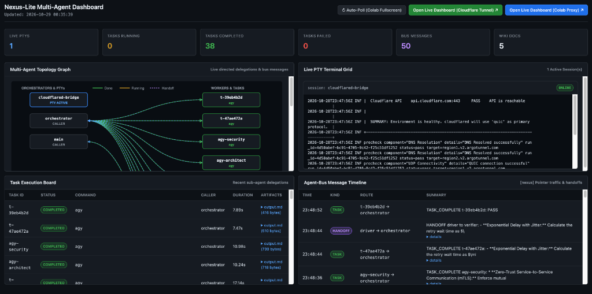
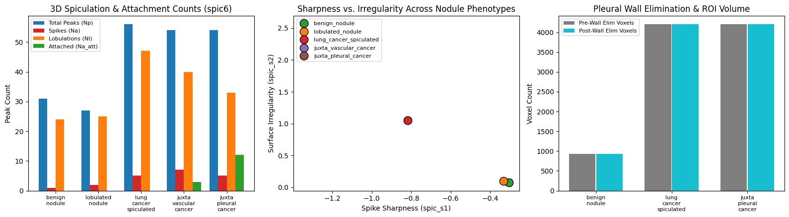
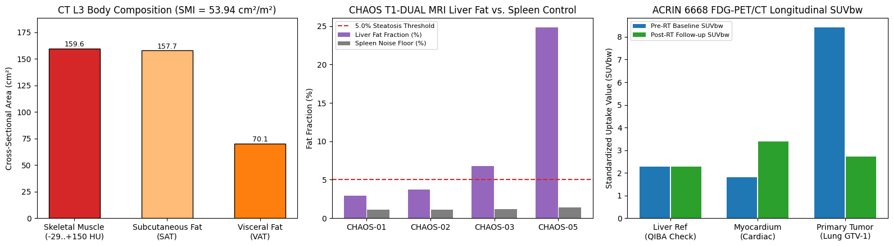
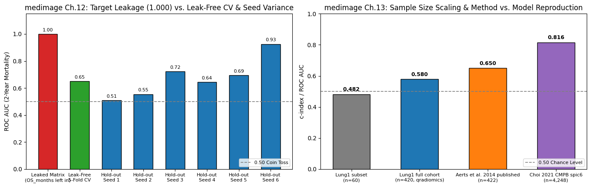

Today we are excited to release **[nexus-lite](https://github.com/choilab-jefferson/nexus.lite)** (`v0.1.2`, MIT License), an ultra-lightweight, Colab-ready multi-agent orchestration toolkit designed to coordinate live CLI coding and research agents—including **Google Antigravity (`agy`)** and **Claude Code (`claude`)**—directly on top of **[qradiomics](/qradiomics/)** and **[medimage](/posts/2026-08-04-introducing-medimage/)**.

With **[qradiomics](/posts/2026-05-20-introducing-qradiomics/)**, we unified twelve years of CHOI Lab radiomics and 3D shape pipelines into an atomic Unix-style CLI (`qr` / `qrdx`). With **[medimage](/posts/2026-08-04-introducing-medimage/)**, we turned those tools into a 13-chapter hands-on Google Colab curriculum. **`nexus-lite` completes the stack**: it gives multiple AI agents a shared, zero-server workspace where they can run parallel radiomics extractions, audit DICOM de-identification, detect survival data leakage, and index every finding into a searchable SQLite FTS5 knowledge wiki—all inside a single free Google Colab notebook or local workstation.

- **Repository:** [github.com/choilab-jefferson/nexus.lite](https://github.com/choilab-jefferson/nexus.lite) · **License:** MIT
- **QRadiomics + MedImage Multi-Agent Colab Notebook:**  
  [](https://colab.research.google.com/github/choilab-jefferson/nexus.lite/blob/main/notebooks/qradiomics_medimage_colab_demo.ipynb)
- **Nexus-Lite Core Primitives & Live `agy` Colab Notebook:**  
  [](https://colab.research.google.com/github/choilab-jefferson/nexus.lite/blob/main/notebooks/nexus_lite_colab_demo.ipynb)

---

## Why `nexus-lite`?

Conventional Python "agent" libraries only chain raw LLM API prompts—they are not true autonomous coding agents with full shell, filesystem, and scientific CLI capabilities. Conversely, real **CLI coding agents** (`agy`, `claude`) are built as single-session interactive terminals that normally require a full workstation harness (such as `loom`) and background daemons to coordinate as a team.

**`nexus-lite` turns standalone CLI coding agents into a coordinated multi-agent system inside Google Colab and Jupyter notebooks** in ~600 lines of pure Python and a single dependency (`pyte`):

1. **Persistent PTY Sessions (`dtach` + `pyte`)**: Spawns detachable background pseudo-terminals rendered through a `120×36` VT100 screen buffer so interactive CLI agents (`agy`, `claude`, `bash`, `python3`) survive across notebook cells.
2. **Zero-Server SQLite WAL Bus & FTS5 Markdown Wiki (`.nexus/lite.db`)**: High-concurrency `WAL` mode message bus with automatic pointer injection (`[nexus] dm <msg_id> ...`) and a full-text searchable Markdown knowledge base (`wiki_fts`).
3. **Parallel Swarms (`nl.run_swarm`) & 3-Stage Role Pipelines (`nl.run_pipeline`)**: Concurrent fan-out/fan-in execution alongside sequential **Karpathy Role Pipelines** (`driver` → `navigator` → `verifier` → `refiner`) with automatic quota fallback (`claude` → `agy`).
4. **Google Colab & Drive Bidirectional Persistence (`nl.ensure_env`)**: Automatically detects Google Colab, mounts `/content/drive/MyDrive`, non-destructively symlinks `~/.gemini` ↔ `/content/drive/MyDrive/.gemini` so `agy` authentication persists across ephemeral Colab sessions, and launches a **Cloudflared Remote Bridge** (`*.trycloudflare.com`) with a live 2×2 HTML5 dashboard.



---

## Part I: Core Multi-Agent Primitives Running Live in Google Colab

Below are the verbatim outputs from running [`notebooks/nexus_lite_colab_demo.ipynb`](https://github.com/choilab-jefferson/nexus.lite/blob/main/notebooks/nexus_lite_colab_demo.ipynb) in Google Colab (Python 3.13, Linux VM) connected to Google Drive and live `agy` agents.

### 1. Google Drive Workspace, `~/.gemini` Credential Sync & Cloudflared Bridge

When `nl.ensure_env(start_bridge_server=True)` runs in Colab, it links `~/.gemini` directly to `/content/drive/MyDrive/.gemini` via a bidirectional symbolic link (so any token refresh in `~/.gemini` is written straight to Google Drive) and opens an authenticated Cloudflared tunnel:

```text
Drive already mounted at /content/drive
Runtime Environment : colab
Nexus Workspace     : /content/drive/MyDrive/nexus-lite
Gemini Auth Sync    : ~/.gemini -> /content/drive/MyDrive/.gemini
Local Bridge URL    : http://127.0.0.1:8765
Public Tunnel URL   : https://essay-judge-andrea-physiology.trycloudflare.com
Live 2x2 Dashboard  : https://essay-judge-andrea-physiology.trycloudflare.com/dashboard?token=0200e3480c2f179715711bf644a0c0d7&refresh=3
```

### 2. Persistent `dtach` PTYs & Live Message Bus Pointer Injection

Agents running inside `dtach` PTY sessions receive real-time pointer notifications whenever a peer agent posts a message or completes a delegated task:

```text
Initial PTY Screen:
 echo 'Agent Alpha online'
Agent Alpha online
bash-5.2#
Bus Message Sent: m-85e00385
PTY Screen After Bus Send:
 echo 'Agent Alpha online'
Agent Alpha online
bash-5.2# [nexus] dm m-85e00385 /content/drive/MyDrive/nexus_workspace/inbox/m-85e00385.md - Coordinate on task #101
Delegation Result: {'task_id': 't-295a40d0', 'caller': 'main', 'status': 'completed', 'rc': 0, 'artifact_dir': '/content/drive/MyDrive/nexus_workspace/artifacts/t-295a40d0', 'output': 'Subtask completed successfully!\n'}
FTS5 Wiki Search Results: [{'slug': 'architecture/database', 'snippet': '# Database\n<b>SQLite</b> <b>WAL</b> mode ensures fast concurrent writes without lock...'}]
```

### 3. Live `agy` Oneshot Delegation, Parallel Swarm, and Sequential Role Pipeline

`nexus-lite` normalizes `agy` (`agy --dangerously-skip-permissions -p ...`) and `claude` (`claude --dangerously-skip-permissions -p ...`) invocations automatically:

```text
=== (a) Oneshot 'agy' Delegation ===
[COMPLETED] (rc=0):
SQLite's Write-Ahead Logging (WAL) mode is ideal for multi-agent state because it enables high-concurrency, non-blocking reads alongside serialized writes within a single local file, eliminating lock contention across parallel agents without the overhead of an external database server.

=== (b) Parallel 'agy' Multi-Agent Swarm ===
[COMPLETED] agy-architect:
* Saga Pattern (Distributed Data Management): Manages data consistency across multiple services without distributed locks (two-phase commits) by breaking a transaction into a sequence of local service transactions, using either choreography (event-driven) or orchestration (centralized coordinator) alongside compensating transactions to roll back changes on failure.
* Circuit Breaker Pattern (Resilience & Fault Tolerance): Prevents cascading failures across synchronous service dependencies by wrapping remote calls in a state machine (Closed, Open, Half-Open) that automatically trips and fails fast—or returns a fallback response—when downstream error rates or latencies exceed a threshold.

[COMPLETED] agy-security:
* Zero-Trust Service-to-Service Communication (mTLS): Enforce mutual TLS (mTLS) across all internal traffic (often via a service mesh like Istio or Linkerd) so that every microservice cryptographically authenticates the caller's identity and encrypts data in transit, eliminating implicit trust within the internal network.
* Centralized Authentication & Fine-Grained Authorization: Offload external authentication and rate limiting to an API Gateway, which exchanges user credentials for short-lived, cryptographically signed tokens (e.g., JWTs with OAuth 2.0/OIDC) that downstream microservices independently validate to enforce least-privilege, role- or attribute-based access control (RBAC/ABAC) at the service level.

=== (c) Sequential 'agy' Role Pipeline (driver -> verifier) ===
Final Pipeline Output:
 PASS
Implement bounded retries (e.g., max 3–5 attempts) exclusively for idempotent requests encountering transient failures (429, 502, 503, 504, or network timeouts) while failing fast on permanent 4xx client errors, spacing attempts using capped exponential backoff with jitter (min(max_delay, base_delay * 2^attempt) + random_jitter) to prevent thundering herds.

Saved final output to wiki: /content/drive/MyDrive/nexus_workspace/wiki/agy/backoff_policy.md
```

---

## Part II: Four Practical `qradiomics` + `medimage` Multi-Agent Workflows

In [`notebooks/qradiomics_medimage_colab_demo.ipynb`](https://github.com/choilab-jefferson/nexus.lite/blob/main/notebooks/qradiomics_medimage_colab_demo.ipynb) (and via the `nexus-lite demo` CLI), we orchestrate four end-to-end medical physics and quantitative imaging workflows.

---

### Demo 1 — 3D Pulmonary Nodule Morphology & Spiculation Swarm (`qradiomics.shape`)

Traditional radiomics extracts ~1,130 texture features that can be difficult to interpret clinically. In contrast, **`qradiomics.shape`** implements two published, glass-box 3D geometric biomarker pipelines from the CHOI Lab:
1. **3D Spiculation (`spic6`, [Choi *et al.*, *CMPB* 2021](https://doi.org/10.1016/j.cmpb.2020.105839))**: Converts a 3D voxel mask into a triangular mesh, maps it onto the unit sphere via cotangent-Laplacian spherical parameterization, measures per-vertex log-area distortion, and classifies surface peaks into acute spikes (`spic_Na`), lobulations (`spic_Nl`), vascular/pleural attachments (`spic_Na_att`), and composite sharpness scores (`spic_s1`, `spic_s2`).
2. **180-D Angular Histogram of Surface Normals (`AHSN`, [Choi & Choi, *CMPB* 2014](https://doi.org/10.1016/j.cmpb.2013.08.015))** and **Iterative Pleural Wall Elimination (`wall_eliminate`)**.

Running `nl.run_phantom_shape_swarm()` dispatches three parallel `agy` workers across 5 synthetic 3D CT lung nodule phantoms (`48×48×48` isotropic `1.0 mm` NRRD volumes):

#### Live Colab Agent Swarm Output (`agy`)

> **`[COMPLETED] spic6-worker-agy`**: The `spic6` feature set cleanly stratifies benign/lobulated phantoms from malignant phenotypes, with the three cancer models exhibiting roughly doubled total surface peak counts (`spic_Np` ≈ 54–56 vs. 27–31), elevated acute spiculation peaks (`spic_Na` = 5–7 vs. 1–2), and a marked shift in composite spiculation scores (`spic_s1` ≤ −0.82, `spic_s2` ≥ 1.05 vs. near-zero benign values). Furthermore, the attached-peak metric (`spic_Na_att`) and remaining free-lung peaks (`spic_Nl`) accurately capture anatomical boundary tethering: isolated lesions register zero attached peaks (`spic_Na_att` = 0), whereas juxta-vascular (`spic_Na_att` = 3) and juxta-pleural (`spic_Na_att` = 12) cancers reflect increasing non-parenchymal contact alongside intensified composite risk scores (`spic_s2` = 2.56).
>
> **`[COMPLETED] ahsn-worker-agy`**: The 180-D Angular Histograms of Surface Normals (AHSN) effectively capture morphological complexity: the malignant phantoms (`soft_lung_cancer_spiculated` and `soft_juxta_pleural_cancer`) exhibit higher entropy (11.55 and 11.36) and lower L2 norms (0.21 and 0.22) than the smooth `soft_benign_nodule` (entropy 9.73, L2 norm 0.30), reflecting more dispersed surface normal orientations caused by spiculation and boundary irregularity.
>
> **`[COMPLETED] manifest-worker-agy`**: `manifest.csv` is ready for `qrdx shape extract --features all` with all 3 CT/mask phantom pairs (`soft_benign_nodule`, `soft_lobulated_nodule`, and `soft_lung_cancer_spiculated`) properly mapped to valid NRRD volumes. The NRRD format preserves 3D isotropic spacing by storing physical voxel dimensions and orientation directly in its header metadata (`space directions` and `spacings`), ensuring accurate physical-space geometric and volumetric radiomics calculations.

#### Extracted 3D `spic6` & `AHSN` Feature Tables (Colab Output)

| Phantom Phenotype | Voxels | `spic_Np` (Peaks) | `spic_Na` (Spikes) | `spic_Nl` (Lobes) | `spic_Na_att` (Attached) | `spic_s1` | `spic_s2` |
|---|---:|---:|---:|---:|---:|---:|---:|
| `soft_benign_nodule` | 925 | 31.0 | 1.0 | 24.0 | 0.0 | -0.3041 | 0.0730 |
| `soft_lobulated_nodule` | 1506 | 27.0 | 2.0 | 25.0 | 0.0 | -0.3326 | 0.1005 |
| `soft_lung_cancer_spiculated` | 4204 | 56.0 | 5.0 | 47.0 | 0.0 | -0.8174 | 1.0499 |
| `soft_juxta_vascular_cancer` | 4201 | 54.0 | 7.0 | 40.0 | 3.0 | -1.3444 | 2.5647 |
| `soft_juxta_pleural_cancer` | 4201 | 54.0 | 5.0 | 33.0 | 12.0 | -1.3444 | 2.5647 |



---

### Demo 2 — HIPAA Safe Harbor DICOM De-Identification & Pixel Parity Pipeline (`medimage` Ch.5 + `qr anonymize`)

Before any clinical CT scan is exported to a cloud notebook, Protected Health Information (PHI) in the DICOM header must be stripped—and **quantitatively verified**—without altering Hounsfield Unit (HU) calibration (`RescaleSlope`, `RescaleIntercept`) or 3D voxel geometry (`PixelSpacing`).

`nl.run_hipaa_privacy_pipeline()` runs a **3-stage Role Pipeline (`driver` → `verifier` → `refiner`)**:
1. **`driver`**: Generates synthetic hospital DICOM slices containing 24 PHI tag instances (`PatientName`, `PatientID`, `PatientBirthDate`, `InstitutionName`, `InstitutionAddress`, `ReferringPhysicianName`, `AccessionNumber`) and executes `qrdx anonymize --replace-pid --pid-salt choilab2026`.
2. **`verifier`**: Audits the anonymized headers to confirm `0` residual PHI findings and verifies bit-for-bit equality of the rescaled 3D HU arrays and `PixelSpacing`.
3. **`refiner`**: Issues the final `CONFIRM` compliance decision and archives the certificate into the FTS5 Wiki (`compliance/dicom_privacy_audit`):

```text
=== Stage [DRIVER] (status=completed) ===
Executed DICOM PS3.15 Annex E de-identification via qrdx_anonymize_cli across 4 CT slices, stripping all Protected Health Information (PHI) tags while preserving image pixel data. The original patient identifier MRN-99887766 was deterministically hashed into the salted SHA-1 pseudonym ANON-e5bd09fa7654.

=== Stage [VERIFIER] (status=completed) ===
PASS
All 24 original PHI instances across the 4 DICOM slices were completely removed (0 remaining), the patient ID was properly pseudonymized to ANON-e5bd09fa7654, and 100% 3D Hounsfield Unit and geometric parity was preserved.

=== Stage [REFINER] (status=completed) ===
CONFIRM
All 24 PHI instances have been verified as removed with salted SHA-1 pseudonymization (ANON-e5bd09fa7654) and 100% 3D HU and geometric parity preserved across all 4 DICOM slices, meeting HIPAA Safe Harbor release criteria.
```

---

### Demo 3 — Multi-Modality Quantitative Medical Imaging Swarm (`medimage` Ch.6, Ch.7, Ch.8)

Modern oncology informatics integrates anatomical and functional imaging across CT, MRI, and PET. `nl.run_multimodal_imaging_swarm()` launches three concurrent domain workers covering Part II of the `medimage` course:

#### Live Colab Agent Swarm Output (`agy`)

> **`[COMPLETED] ct-bodycomp-worker-agy` (`medimage` Ch.6 — L3 CT Body Composition)**: These L3 CT metrics indicate healthy skeletal muscle mass and density, with a skeletal muscle index of 53.94 cm²/m² (above standard sarcopenia thresholds) and a mean muscle attenuation of 44.3 HU (reflecting normal muscle quality without significant myosteatosis). Adipose distribution is predominantly subcutaneous (157.73 cm²) with moderate, non-visceral-obesity levels of visceral adipose tissue (70.08 cm², well below the typical 100 cm² metabolic risk cutoff).
>
> **`[COMPLETED] mri-steatosis-worker-agy` (`medimage` Ch.7 — CHAOS T1-DUAL Chemical-Shift MRI)**: Across all four scans, the spleen reference region maintains a consistently low baseline noise floor (1.1%–1.4%), confirming reliable fat-water separation and minimal measurement bias. Against the 5.0% clinical threshold, **CHAOS-01** (2.9%) and **CHAOS-02** (3.7%) show normal hepatic lipid levels, whereas **CHAOS-03** (6.8%) and **CHAOS-05** (24.8%) test positive for mild and severe hepatic steatosis, respectively, well above background noise.
>
> **`[COMPLETED] pet-suv-worker-agy` (`medimage` Ch.8 & [Choi *et al.*, *JCO CCI* 2024](https://doi.org/10.1200/CCI.23.00241))**: The reference liver SUV of 2.27 falls squarely within the QIBA physiological quality-control range (1.5–3.0), confirming reliable longitudinal FDG-PET/CT calibration across timepoints. Clinically, the gross tumor volume (GTV) demonstrated a robust metabolic treatment response with a 67.7% SUV reduction (8.41 → 2.72), whereas myocardial uptake increased by +1.58 SUV (1.81 → 3.39), indicating physiological shifts in cardiac glucose metabolism or potential treatment-related cardiotoxicity.

| CHAOS Subject | Liver Fat Fraction (%) | Spleen Noise Floor (%) | Steatosis (> 5.0%) |
|---|---:|---:|---|
| `CHAOS-01` | 2.9% | 1.1% | `False` (Normal) |
| `CHAOS-02` | 3.7% | 1.1% | `False` (Normal) |
| `CHAOS-03` | **6.8%** | 1.2% | **`True` (Mild Steatosis)** |
| `CHAOS-05` | **24.8%** | 1.4% | **`True` (Severe Steatosis)** |



---

### Demo 4 — NSCLC-Radiomics (Lung1) Data-Leakage & Reproducibility Audit (`medimage` Ch.12 & Ch.13)

High-dimensional radiomics studies (~1,130 features per patient) are vulnerable to three methodological pitfalls taught in `medimage` Chapters 12 and 13:
1. **Target Leakage**: Leaving survival columns (`OS_months`, `OS_event`) inside the feature matrix when predicting 2-year mortality (`dead_2y`), producing a suspiciously perfect `AUC = 1.000`.
2. **Small Hold-Out Variance**: Splitting a 60-patient subset into an 18-patient test set, where random seed choice alone swings hold-out AUC from `0.508` to `0.925`.
3. **Multiple Hypothesis Testing**: Testing 1,130 `nsclc-survival` features at *p* < 0.05 yields `~56.5` false positives by pure chance unless controlled via Bonferroni correction (α = 4.42 × 10⁻⁵) and out-of-fold validation.

`nl.run_lung1_audit_pipeline()` executes a **3-stage Role Pipeline (`driver` → `navigator` → `verifier`)** that diagnoses all three failure modes and compares cohort-scale reproducibility against **Aerts *et al.* 2014 (*Nature Communications*)** and **Choi *et al.* 2021 (*CMPB*)**:

| Study / Cohort | Metric | Value | Methodological Takeaway |
|---|---|---:|---|
| Lung1 subset (*n* = 60) | c-index | `0.482` | Underpowered; confidence interval spans `0.50` chance |
| Lung1 full cohort (*n* = 420, `qradiomics`) | c-index | `0.580` | Prognostic direction reproduces (`original_ngtdm_Busyness`) |
| Aerts *et al.* 2014 published (*n* = 422) | c-index | `0.650` | Original published reference |
| **Choi 2021 *CMPB* `spic6` (*n* = 4,248)** | **AUC** | **`0.816`** | **Algorithmic 3D geometric method reproduces paper (`0.80–0.85`)** |



---

### SQLite FTS5 Knowledge Wiki & Live `agy` Clinical Physics Synthesis

Every swarm worker and pipeline verifier writes its structured Markdown report into the SQLite FTS5 knowledge base (`.nexus/wiki/`). In the final cell of the Colab notebook, querying the wiki and delegating a synthesis prompt to `agy` produces:

```text
=== Indexed FTS5 Wiki Documents ===
- compliance/dicom_privacy_audit (983 bytes)
- modalities/ct_body_composition (896 bytes)
- modalities/mri_dixon_steatosis (1018 bytes)
- modalities/pet_ct_suv (885 bytes)
- radiomics/ahsn_wall_elim (2363 bytes)
- radiomics/phantom_manifest (1631 bytes)
- radiomics/spic6_phantoms (2629 bytes)
- reproducibility/lung1_aerts2014_audit (3018 bytes)

=== Live 'agy' Clinical Physics Co-Pilot Synthesis ===
- Leakage-Safe CV Prevents Over-Optimism and False Discoveries: Excluding post-baseline outcome variables (OS_months, OS_event) and applying 5-fold cross-validation corrects an artificially inflated AUC of 1.000 down to a realistic 0.651 while mitigating small-sample single-split variance (0.508–0.925 for n=18) and guarding against the ~56.5 expected false positives when screening 1,130 features (α_adj = 4.42e-05).
- Geometric Shape Descriptors (spic6) Deliver Robust, Scalable Reproducibility: Unlike high-dimensional feature screening in underpowered cohorts (n=60, C-index 0.482) or standard radiomics on larger cohorts (n=420–422, C-index 0.580–0.650), targeted geometric descriptors (spic6, n=4,248) achieve strong prognostic discrimination (0.816) that reproduces published benchmarks (0.80–0.85).
```

---

## Quick Start (Colab & Local CLI)

Install `nexus-lite` and `qradiomics` in Google Colab or any local Python 3.10+ environment:

```bash
pip install "git+https://github.com/choilab-jefferson/nexus.lite.git" qradiomics

# Run all 4 multi-agent demos from the CLI (auto-detects agy / claude)
nexus-lite demo phantom-swarm --agent agy
nexus-lite demo hipaa-pipeline --agent claude
nexus-lite demo multimodal-swarm --agent agy
nexus-lite demo lung1-audit --agent agy

# Search the indexed SQLite FTS5 Markdown Wiki
nexus-lite wiki search "spic6 OR AHSN OR HIPAA OR Bonferroni"
```

---

## Acknowledgements

We gratefully acknowledge **Google** for providing **Gemini 4 Argon** access and compute support, which powered the multi-agent orchestration, quantitative radiomics synthesis, and automated methodological auditing across **[nexus-lite](https://github.com/choilab-jefferson/nexus.lite)**, **[qradiomics](/qradiomics/)**, and **[medimage](/posts/2026-08-04-introducing-medimage/)**.

---

*Computational Healthcare & Oncology Informatics (CHOI) Lab, Department of Radiation Oncology, Sidney Kimmel Medical College at Thomas Jefferson University* · [Wookjin Choi, Ph.D.](/profile/) · MIT License
