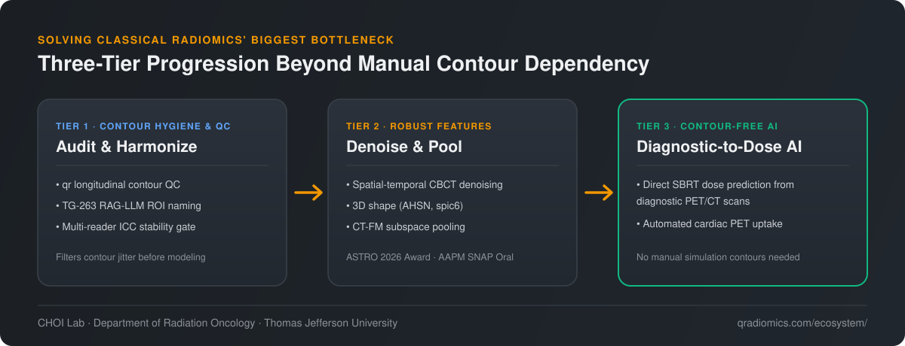
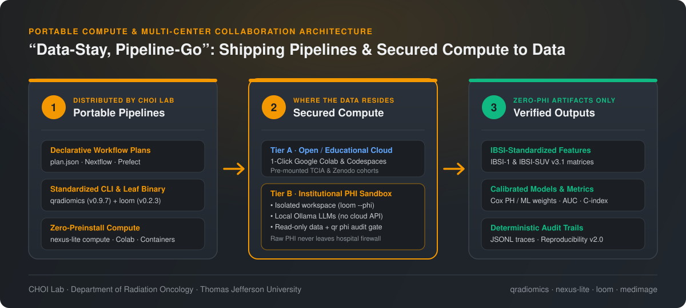

Why do so many promising radiomics and medical AI studies struggle to cross the finish line into routine clinical care? Across two decades of quantitative imaging research, our experience at the **Computational Healthcare & Oncology Informatics ([CHOI Lab](/about/))** at Thomas Jefferson University points to three recurring barriers:

1. **Fragmented, Non-Reproducible Software**: Research pipelines are often scattered across legacy MATLAB scripts, custom C++ binaries, and ad-hoc notebooks without standardized physical units or end-to-end verification.
2. **Contour (Segmentation) Dependency**: Classical radiomic features are highly sensitive to manual delineation variability, inter-observer differences, and longitudinal registration jitter.
3. **The Data-Sharing Bottleneck**: Moving raw multi-institutional patient imaging (DICOM) and electronic health records (EHR) across hospital firewalls is slow, legally complex, and often impractical.

This post provides a unified overview of **what the CHOI Lab has done (Past)**, **what we are doing today (Present)**—including how our open-source stack evolved from our **AAPM 2025 scalable pipeline** into **[qradiomics](/qradiomics/)**, **[nexus-lite](/nexus-lite/)**, **[loom](/loom/)**, and **[medimage](/posts/2026-08-04-introducing-medimage/)**—and **what we aim to do next (Future)** through **contour-robust/contour-free modeling** and a **"Data-Stay, Pipeline-Go"** portable compute architecture.

---

## 1. What We Have Done (Past: 2002–2023) — Glass-Box Foundations & Benchmark Datasets

Before building our modern Python and agentic stack, our work focused on designing **mathematically interpretable ("glass-box") 3D biomarkers** that translate clinicians' visual domain knowledge into rigorous geometric and physical formulations:

- **3D Surface Normal & Shape Radiomics (`AHSN`)**: Developed the 180-dimensional Angular Histogram of Surface Normals (`AHSN`, *Computer Methods and Programs in Biomedicine* 2014) and multi-scale Hessian dot/surface filters for automated pulmonary nodule detection and chest wall elimination.
- **Low-Dose CT Lung Cancer Screening (`radiomics50`)**: Established a compact, reproducible radiomic signature for early lung cancer detection (*Medical Physics* 2018, **Editor's Pick**; LUNGx Challenge top performer; Kaggle Data Science Bowl 2017 Bronze Medal).
- **Conformal 3D Spiculation (`spic6`) & `CIRDataset`**: Formulated conformal spherical parameterization area-distortion peaks to quantify nodule spiculation and lobulation (*CMPB* 2021) and released **[CIRDataset](https://github.com/choilab-jefferson/CIR)** (*MICCAI* 2022; Zenodo `6762573`), comprising **966 radiologist QA/QC'd nodule masks** (883 LIDC-IDRI + 83 LUNGx).
- **Pathway-Grounded Deep Learning (`PathCNN`) & 4D-CT Optimization**: Integrated multi-omics biological pathway graphs into interpretable CNNs for glioblastoma survival prediction (**[PathCNN](https://github.com/mskspi/PathCNN)**, *Bioinformatics / ISMB* 2021) and developed patient-specific contrast-enhanced 4D-CT simulation protocols (*Medical Physics* 2016; U.S. Patent `9,456,798 B2`).

Historically, these methods lived across three separate repositories—`taznux/lung-image-analysis` (MATLAB), `taznux/radiomics-tools` (C++/ITK/Ruffus), and `choilab-jefferson/LungCancerScreeningRadiomics` (MATLAB/Python/C++). Unifying them into a single, dependency-clean platform became our primary software engineering goal.

---

## 2. What We Are Doing (Present: 2024–2026) — Unification, Open-Source Stack & Clinical Translation

### A. From the AAPM 2025 Pipeline Prototype to the 2026 Unified Open-Source Stack

At **AAPM 2025** (*"Development and Validation of a Scalable Radiomics Pipeline for Lung Cancer Research Using Clinical and Public Datasets"*), we demonstrated an initial Prefect-orchestrated Python pipeline across **1,119 patients and 25,308 tasks** (TJU longitudinal CT/CBCT, TCIA NSCLC-Radiomics, and TCIA NSCLC-Cetuximab). At that stage, multi-agent planning, LLM reporting, and automated QA modules were still in early development, and naive fusion of raw longitudinal CBCT features yielded modest survival discrimination (mean AUC `0.54–0.58`).

Over the past year, we resolved those limitations and released our complete four-layer open-source ecosystem under the **[CHOI Lab GitHub Organization (`choilab-jefferson`)](https://github.com/choilab-jefferson)**:

| Open-Source Layer | Package & Version | License & Links | Key Improvements Since AAPM 2025 |
| :--- | :--- | :--- | :--- |
| **1. Domain CLI & Standardized Library** | **[`qradiomics`](/qradiomics/)** (`qr` CLI `v0.9.6`) | **MIT** [GitHub](https://github.com/choilab-jefferson/qradiomics) · [PyPI](https://pypi.org/project/qradiomics/) | • Unifies all 3 legacy MATLAB/C++ repos into pure Python (`pip install qradiomics`) • **100% IBSI-1 & IBSI-SUV v3.1 PET parity** (58/58 DRO + 16/16 ACRIN 6668) • Multi-engine extraction (`pyradiomics`, `pysera`, `rtools`) + `qradiomics.shape` (`AHSN`, `spic6` in seconds vs. minutes in C++) • Deformable registration (`sitk`, `plastimatch`, `elastix`), `qr hu-correct`, `qr longitudinal` contour QC, `qr delta`, and `qr bench` ML suite • Dual **Nextflow** (default) + **Prefect** + **inline** workflow scaffolding (`qr workflow`) and `.claude/skills/qradiomics/` |
| **2. Multi-Agent Orchestrator & Portable Compute** | **[`nexus-lite`](/nexus-lite/)** (`v0.2.2`) | **MIT** [GitHub](https://github.com/choilab-jefferson/nexus.lite) · [PyPI](https://pypi.org/project/nexus-lite/) | • Replaces early prototype agent frameworks with a zero-server Python stdlib kernel (`dtach` PTYs, SQLite WAL Bus v1, 3-tier memory `stm`/`mtm`/`ltm`) • **Zero-preinstall remote compute (`nexus_lite.compute`)** over SSH, SLURM (`srun`/`sbatch`), and Cloudflared Colab tunnels • Opt-in PHI gate (`NEXUS_SENSITIVITY=phi`) routing swarms strictly to local Ollama models • Ships with **6 self-contained Google Colab notebooks** |
| **3. Sandboxed Leaf-Agent Binary** | **[`loom`](/loom/)** (`nexus.loom` `v0.2.3`) | **MIT** [GitHub](https://github.com/choilab-jefferson/nexus.loom) · [Releases](https://github.com/choilab-jefferson/nexus.loom/releases) | • Zero-dependency **Go 1.22+ stdlib static binary** (`./bin/loom`) • Symlink-resolving `--workspace` sandbox, allowlisted commands (`--allow-cmd`), timeout clamping, and hard turn/token/time budgets • Multi-turn `loom.context.v1` stdin/stdout piping and **`--phi` local-only model confinement** |
| **4. Open Curriculum, Datasets & AI Co-Pilot** | **[`medimage`](/posts/2026-08-04-introducing-medimage/)** · **[`CIR`](https://github.com/choilab-jefferson/CIR)** · **[`PathCNN`](https://github.com/mskspi/PathCNN)** · **[Medical Physics Gem](/posts/2026-05-24-announcing-gemini-gem-for-computational-medical-physics/)** | **MIT** / Open Access | • **13-chapter zero-setup Google Colab course** (`medimage`) from DICOM basics to reproducing Aerts 2014 • **Reproducibility Report v2.0**: reproduces **8 published studies** end-to-end with `qradiomics` alone (no MATLAB, no Docker) |

### B. End-to-End Reproducibility Across 8 Published Protocols

Rather than validating pipeline runtime alone, `qradiomics` ships deployable pipeline bundles (`pipelines/lung1/`, `pipelines/nsclc_cetuximab/`, `pipelines/lidc_idri/`, `pipelines/acrin_heart/`) that quantitatively reproduce eight peer-reviewed benchmarks out of the box:

| Benchmark Study | Cohort | Protocol | `qradiomics` Result | Published Reference |
| :--- | :--- | :--- | :--- | :--- |
| **Aerts et al. 2014** (*Nat Commun*) | TCIA Lung1 ($n=420$) | Univariate & 5-fold CV Cox PH (`Busyness` $p < 10^{-4}$) | **c-index `0.580 ± 0.029`** | `0.65` |
| **Aerts et al. 2014 (External)** | Lung1 $\to$ NSCLC-Cetuximab ($n=460$) | 4-feature signature external transfer | **c-index `0.562`** | `0.69` |
| **Choi & Choi 2014** (*CMPB*) | LIDC-IDRI ($1,018$ scans, $33,108$ candidates) | 180-D `AHSN` + patient-grouped 5-fold CV | **AUC `0.727 ± 0.005`** | `0.85–0.93` |
| **Choi et al. 2018** (*Med Phys*) | LIDC-IDRI ($4,248$ nodules) | `radiomics50` ($1,409 \to$ top 50) | **AUC `0.872 ± 0.010`** | `0.83–0.95` |
| **Choi et al. 2021** (*CMPB*, `spic6`) | LIDC-IDRI ($4,248$ nodules) | 6 interpretable spiculation features (`spic6`) | **AUC `0.816 ± 0.006`** | `0.80–0.85` (Exact) |
| **Choi et al. 2021** (*CMPB*, LIDC-PM) | LIDC Pathology-Confirmed ($n=72, 474$ nodules) | `radiomics+spic` on `CIRDataset` masks | **AUC `0.868 ± 0.039`** | `0.85` (Exceeds) |
| **Choi et al. 2021 / 2022** (LUNGx External) | LIDC ($4,248$) $\to$ LUNGx ($73$ size-matched) | `radiomics50` + 10-patient calibration | **AUC `0.756`** | `0.76` (Exact) |
| **Choi et al. 2024** (*JCO CCI*) | TJU pre-RT $\to$ ACRIN 6668 / HeartCB post-RT | `rtools` + PyRadiomics cardiac FDG-PET uptake | **Accuracy `0.80 / 0.78`** | `0.80 / 0.78` (Exact) |

### C. Active Clinical Translation Highlights (2025–2026)

- **Longitudinal CBCT & Early Adaptive Lung Radiotherapy**: By replacing naive feature concatenation with CBCT-to-CT HU harmonization (`qr hu-correct`), deformable registration (`qr register`), longitudinal contour QC (`qr longitudinal`), and **hierarchical spatial-temporal progressive denoising** ([AAPM 2026 SNAP Oral `SU-315-GPD-T-25`](/posts/2026-07-06-8-abstracts-accepted-aapm-2026/)), our longitudinal CBCT trajectory fusion model was honored with the **[2026 ASTRO Annual Meeting Basic Transitional Award in Physics](/posts/2026-07-27-2026-astro-annual-meeting-abstract-award/)** (top 30 of >2,000 submissions; [*IJROBP* 126(1) S91](/posts/2026-10-01-astro-2026-abstracts-boston/)).
- **Functional Cardiac PET & 4DCT Toxicity Prediction**: Published 4DCT-ventilation/perfusion radiation pneumonitis modeling (*Radiotherapy and Oncology* 2025) and cross-cohort late-fusion cardiac PET risk stratification (*JCO CCI* 2024; ASTRO 2026 Quick Pitch Oral `S296`; AAPM 2026 `SU-315-GPD-R-23`).
- **Clinical LLMs (`TRACER`) & Automated Physics QA**: Published **[TRACER](/posts/2026-07-01-tracer-open-source-llms-cardiac-event-extraction/)** (*IJROBP* 2026, in press; featured in [*Jefferson Investigates*](/posts/2026-08-31-jefferson-investigates-features-tracer/)), extracting cardiac events across 411 EHR charts in **20–42 seconds per chart vs. ~2 hours manually**, alongside multi-tier **TG-263 RAG-LLM contour name standardization** (`AAPM 2026 SU-115-220-8`), high-risk bone metastasis LLM triage (*IJROBP* 2026 `e412`), population plan quality scoring (*IJROBP* 2026 `e231`), and vendor-agnostic treatment plan QA (`AAPM 2026 SU-315-GPD-T-1025`).

---

## 3. What We Aim to Do (Future: 2026–2030+) — Solving Contour Dependency & Scaling via Portable Compute

Looking critically at our own benchmarks and clinical deployments, two strategic priorities define our next horizon.

### Priority 1: Overcoming Contour Dependency (From Contour Hygiene to Contour-Free Clinical AI)

Our LIDC-IDRI benchmarks highlight a fundamental vulnerability of classical radiomics: moving from raw multi-reader XML contours to radiologist-curated `CIRDataset` masks shifts pathology-confirmed malignancy AUC from `0.748` to `0.868` ($\Delta\text{AUC} = +0.120$). In longitudinal CBCT, fraction-to-fraction contour propagation jitter can easily mask true biological treatment response. We are tackling contour dependency across three progressive tiers:

1. **Automated Contour Standardization & Pre-Extraction QC (`qr longitudinal` & TG-263 RAG-LLM)**: Before extracting a single texture feature, `qr longitudinal` audits multi-timepoint RTSTRUCT trajectories for volume jumps, surface displacement, and contour noise, paired with our RAG-LLM pipeline for automatic TG-263 nomenclature harmonization and intraclass correlation (`ICC`) feature stability filtering.
2. **Spatial-Temporal Progressive Denoising & Boundary-Robust Shape Representations**: Rather than relying on brittle single-slice masks or heavy mesh reconstructions, we aggregate features across spatial sub-volumes and temporal fractions (`AAPM 2026 SU-315-GPD-T-25`) and develop 3D geometric descriptors (`qradiomics.shape`) and CT foundation-model compartment pooling (`qradiomics.deep`) that remain stable under minor boundary perturbations.
3. **Direct Diagnostic-to-Treatment (Contour-Free) AI**: At the earliest multidisciplinary tumor board consult, simulation CT and manual target/OAR contours do not yet exist. We are advancing **contour-free SBRT dose and toxicity prediction directly from pre-treatment diagnostic PET/CT scans** (AAPM 2024 & 2025; TJU Invention Disclosure), enabling rapid treatment risk assessment before manual contouring begins.

### Priority 2: "Data-Stay, Pipeline-Go" — Sharing Portable Pipelines and Secured Compute Environments

In multi-institutional oncology research, asking hospitals to export raw DICOM archives and EHR text is a major bottleneck. **Code assets and portable execution environments are orders of magnitude easier, faster, and safer to distribute than raw patient data.**

Instead of centralizing sensitive data, our architecture is built around **shipping the pipeline and a self-contained, secured computing environment directly to the data**:

- **For Open Science & Education**: Anyone can launch our 6 **[nexus-lite](/nexus-lite/)** Colab notebooks, the **[LUNG1 survival Colab notebook](https://colab.research.google.com/github/choilab-jefferson/qradiomics/blob/main/examples/lung1_survival_colab.ipynb)**, or the 13-chapter **[medimage](/posts/2026-08-04-introducing-medimage/)** course in a browser with zero local setup—sharing the **entire pre-configured compute environment alongside the pipeline**.
- **For Multi-Center Clinical Collaboration**: Partner institutions keep raw patient imaging and EHRs inside their own firewall. Using `scripts/kickoff.sh`, containerized runners, and **[loom](/loom/)** (`--phi` local-only model confinement + strict workspace sandboxing), collaborators deploy our standardized pipelines locally on their own hardware or HPC cluster and share only verified, de-identified summary metrics and calibrated models.

### Priority 3: Principled Multi-Modal AI Embeddings & Cyber-Resilient Oncology

Building on our selection for the **[NCI AI Embeddings Innovation Lab](/posts/2026-07-27-selected-nci-ai-embeddings-innovation-lab/)** (*"AI Embeddings for Next-Gen Cancer Diagnostics"*, July 2026) and our active **NIH/AHRQ R18 grant (`R18HS030060`, 2024–2029)** on ransomware attack response resiliency in radiation oncology, we are fusing interpretable imaging biomarkers (`qradiomics`), histopathology, biological pathways (`PathCNN`), and LLM-extracted EHR trajectories (`TRACER`) into unified multi-modal diagnostic embeddings—backed by cyber-resilient clinical infrastructure.

---

## Explore the Ecosystem

All public packages, reproducible cohort bundles, and educational courses are available today:

- **QRadiomics CLI (`v0.9.6`, MIT):** [Overview](/qradiomics/) · [GitHub (`choilab-jefferson/qradiomics`)](https://github.com/choilab-jefferson/qradiomics) · [PyPI (`pip install qradiomics`)](https://pypi.org/project/qradiomics/)
- **nexus-lite Multi-Agent Orchestrator (`v0.2.2`, MIT):** [Overview & 6 Colab Notebooks](/nexus-lite/) · [GitHub (`choilab-jefferson/nexus.lite`)](https://github.com/choilab-jefferson/nexus.lite) · [PyPI (`pip install nexus-lite`)](https://pypi.org/project/nexus-lite/)
- **loom Sandboxed Leaf-Agent CLI (`v0.2.3`, MIT):** [Overview](/loom/) · [GitHub (`choilab-jefferson/nexus.loom`)](https://github.com/choilab-jefferson/nexus.loom) · [Prebuilt Binaries](https://github.com/choilab-jefferson/nexus.loom/releases)
- **medimage 13-Chapter Colab Course (MIT):** [Course Guide](/posts/2026-08-04-introducing-medimage/) · [GitHub (`choilab-jefferson/medimage`)](https://github.com/choilab-jefferson/medimage)
- **Datasets & Domain AI Assistant:** [CIR / CIRDataset](https://github.com/choilab-jefferson/CIR) · [PathCNN](https://github.com/mskspi/PathCNN) · [Computational Medical Physicist Gemini Gem](/posts/2026-05-24-announcing-gemini-gem-for-computational-medical-physics/)
- **About the CHOI Lab & Director Profile:** [About the Lab](/about/) · [Wookjin Choi, Ph.D.](/profile/) · [Open-Source Projects Index](/projects/2016-08-27-open-source-projects/)
